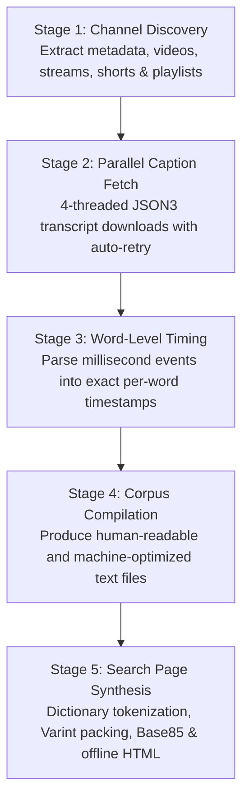

# 🚀 ChannelScraper 2.0 — The Complete YouTube Channel Transcription & Offline Search Suite

> **A 100% autonomous, zero-dependency, standalone offline platform to scrape, transcribe, timestamp, tokenize, and generate an ultra-compressed, serverless search engine for ANY YouTube channel.**

---

## 🌟 Executive Summary

**ChannelScraper 2.0** turns any YouTube channel into an **instant, offline, searchable knowledge base**:
1. **Scrapes Everything:** Regular uploads, live streams, shorts, and playlists (including unlisted videos).
2. **High-Speed Parallel Processing:** Downloads YouTube captions and computes word-level millisecond timestamps using multi-threaded workers.
3. **Smart Incremental Updater (`update.bat`):** Detects brand-new uploads AND detects when a channel owner trims/cuts even **1 single second** out of an existing video, automatically refreshing stale transcripts.
4. **Breakthrough Offline Compression:** Shrinks hundreds of hours of transcripts (tens of millions of words) into a single standalone `search.html` file (~23 MB) with **0% data loss**, opening in any browser in less than a second without internet, servers, or external libraries.
5. **Universal & Portable:** No hardcoded paths, no channel-specific locks. Runs on any Windows, Linux, or macOS machine from any folder or USB stick.

---

## 📁 Directory Architecture Map

```
ChannelScraper/
│
├── 🚀 1-Click Windows Launchers
│   ├── run.bat                 # Start GUI Dashboard (opens in browser at http://localhost:8760)
│   ├── update.bat              # Smart incremental sync & 1s-precision trim detection
│   ├── continue.bat            # Resume interrupted jobs without restarting
│   ├── find_duplicates.bat     # Detect duplicate & re-uploaded videos across a channel
│   └── stop.bat                # Gracefully terminate background workers
│
├── 📄 Documentation & Setup
│   ├── README.md               # Complete architecture & manual
│   └── requirements.txt        # Optional high-compression package
│
├── 📁 User Data & Workspaces
│   ├── output/                 # Master production files (search.html & transcripts)
│   └── runs/                   # Isolated workspaces per channel/run
│
└── ⚙️ Internal Core Engine (core/)
    ├── app.py                  # Web GUI dashboard server (http.server)
    ├── pipeline.py             # 5-stage scraping, timing & compilation engine
    ├── build_search.py         # Ultra-compressed offline search compiler
    ├── update_channel.py       # Smart incremental updater engine
    ├── continue_run.py         # Recovery & continuation engine
    ├── find_duplicates.py      # Duplicate detection engine
    ├── bin/yt-dlp.exe          # Pre-packaged extractor binary
    └── ui/index.html           # Web dashboard UI
```

---

## ⚡ Quick Start Guide (Windows)

### Prerequisites
- **Python 3.10 or newer** installed from [python.org](https://www.python.org/downloads/).
  *(Make sure to check the box: **"Add Python to PATH"** during installation).*
- `yt-dlp` is **already included** in `bin/yt-dlp.exe` — you do not need to install it!

### 🎯 3 Ways to Run ChannelScraper

#### Option 1: The Modern Web GUI (Recommended for Everyone)
1. Double-click **`run.bat`**.
2. Your browser will automatically open: `http://localhost:8760`.
3. In the quick-start box, paste the link of ANY YouTube channel:
   ```
   https://www.youtube.com/@ChannelName
   ```
4. Click **«⚡ ابدأ التفريغ والبحث الآن»** (Start All).
5. Sit back! The tool will automatically run all 5 stages, stream live progress to your screen, and pop open `search.html` the instant it finishes.

#### Option 2: Smart Incremental Channel Updates
Whenever new videos are uploaded to the channel, or if the channel owner deletes/edits parts of a video:
1. Double-click **`update.bat`**.
2. The updater will automatically:
   - Check all uploads across `/videos`, `/streams`, `/shorts`, and `/playlists`.
   - Detect new videos and download their transcripts.
   - Detect trimmed videos (even a 1-second cut!), wipe stale cache, and fetch the fresh transcript.
   - Re-merge and rebuild `search.html` in ~12 seconds!

#### Option 3: Command-Line Interface (CLI)
You can run any operation directly from terminal or PowerShell:
```bash
# Scrape an entire channel end-to-end
python pipeline.py --url https://www.youtube.com/@ChannelName --run-all

# Run incremental update on the active channel
python update_channel.py

# Rebuild search.html with maximum Zopfli compression
python build_search.py --compress --zopfli
```

---

## 🔄 The 5-Stage Pipeline Explained



1. **Stage 1 — Channel Discovery (`data/channel.jsonl`):**
   Queries YouTube tabs using `--flat-playlist` to discover video IDs, titles, durations, and URLs without downloading heavy video streams.
2. **Stage 2 — Parallel Caption Fetching (`caps/<id>.*.json3`):**
   Downloads raw YouTube caption tracks in parallel workers. Stores failures in `logs/failed.tsv` for automatic non-blocking retry.
3. **Stage 3 — Word-Level Timestamp Alignment (`words/<id>.json`):**
   Parses caption segments and word timing offsets into exact seconds (`[(second, word), ...]`).
4. **Stage 4 — Compilation & Merge (`output/<channel>_*.txt`):**
   Produces two master formats:
   - `_formatted.txt`: Line-by-line reading view with video titles and YouTube jump links.
   - `_unformatted.txt`: Ultra-dense tab-separated corpus ready for search indexing.
5. **Stage 5 — Standalone Search Engine Synthesis (`output/search.html`):**
   Compresses millions of words into the self-contained offline search page.

---

## 🗜️ The Offline Search Engine Architecture (`search.html`)

The compiled `search.html` file requires **no web server, no database, no internet connection, and zero external CDN scripts**. You can email it, load it from a USB flash drive, or host it as a static page anywhere.

### 🔬 Technical Breakthrough: Hybrid Binary Varint Tokenization
In a channel with millions of words, raw JSON exceeds 130 MB, and standard Base64 gzip inflates to >40 MB. ChannelScraper 2.0 solves this using an advanced hybrid architecture:

| Metric | Pre-Compression (Original) | ChannelScraper 2.0 (New) | Net Improvement |
|---|---|---|---|
| **Raw Uncompressed Size** | `134.3 MB` (JSON strings) | `35.2 MB` (Binary container) | **-73.8% smaller** |
| **Final File Size** | `41.42 MB` | **`23.04 MB`** (Zopfli) / `23.58 MB` (gzip) | **-41.7% smaller (-17.2 MB)** |
| **Client Startup Time** | ~1.4 seconds | **~0.75 seconds** | **2x faster load** |
| **Information Loss** | 0% | **0.000% (Mathematically Lossless)** | Every byte verified |

#### How it works under the hood:
1. **Word Frequency Dictionary:**
   Scans all 11+ million words. In Arabic, ~250 core words account for 50% of the entire language corpus. All words are sorted by frequency into a compact dictionary string.
2. **Variable-Length Binary Tokens (Varint):**
   Replaces words with variable-length integers:
   - Top 128 words encode in a **single byte** (`0x00..0x7F`).
   - Words 128 to 16,383 encode in **two bytes**.
3. **Hybrid Binary Container:**
   Packs `[4-byte big-endian json_len][meta_json][varint_token_stream]` into a single contiguous binary buffer.
4. **Safe Base85 Encoding:**
   Standard Base64 adds 33.3% overhead. Base85 reduces this to only 25%, using an 85-character ASCII alphabet carefully selected to avoid HTML parser conflicts (`<`, `>`, `\`, `"`, `&`).
5. **Native Browser Decompression:**
   The browser decodes the Base85 string into a `Uint8Array`, piping it through the browser's native `DecompressionStream("gzip")` API at **~160 ms** speed, followed by zero-copy Varint parsing in **~400 ms**.

---

## 🔍 Search Engine Capabilities

- **Fuzzy & Flexible Arabic Matching:**
  Normalizes prefixes (`ال`, `و`, `ف`, `ب`, `ك`, `ل`), suffixes (`ها`, `هم`, `كم`, `نا`, `ين`, `ات`), and letter variants (`أ/إ/آ/ٱ` $\to$ `ا`, `ة/ه` $\to$ `ه`, `ي/ى` $\to$ `ي`).
- **Proximity Search (البحث بالتقارب):**
  Search for 2 to 4 words occurring within a customizable distance (e.g. within 100 words of each other), even if the words span across different transcript lines or minute boundaries!
- **Word-Level Second Precision:**
  Clicking on any highlighted word in the search results opens YouTube at the **exact second** the word was spoken.
- **Reader Modal (سياق الكلام):**
  Clicking "… المزيد" opens the full surrounding paragraph in an elegant reading modal, letting you inspect the complete context of the speaker.
- **Word Deletion & Local Restoration (🗑 حذف الكلمة):**
  Allows hiding specific words locally (e.g. filler words or erroneous transcriptions) with instant local storage persistence and one-click restoration from settings.
- **Bookmarks Basket (الملف):**
  Collect video clips from different searches into a personal basket and export them as:
  - An interactive **HTML Report**
  - A clean **CSV Spreadsheet**
  - A formatted **TXT Document**

---

## 🛠️ Utility Scripts

- **`continue_run.py` (`continue.bat`):**
  If your computer restarts or internet drops during a long scrape, running `continue.bat` resumes downloading and processing right where it left off without re-downloading existing captions.
- **`find_duplicates.py`:**
  Analyzes word overlap across all videos in the channel to identify re-uploaded videos, excerpts, or duplicate episodes, generating `output/duplicates_report.html`.
- **`stop.bat`:**
  Safely shuts down the local web server and background processes on ports 8760 and 8761.

---

## ❓ Frequently Asked Questions (FAQ)

#### Q: Can I use this for non-Arabic channels (English, French, etc.)?
**Yes.** ChannelScraper's discovery, parallel caption fetcher, timestamp aligner, and offline search engine are language-agnostic. For Arabic text, it applies advanced Arabic letter-folding and morphology; for Latin and other scripts, it performs clean standard regex and case-folding.

#### Q: What if a video has no captions on YouTube?
Videos without speech or where YouTube has not generated captions are safely recorded in `logs/failed.tsv`. The tool never crashes; it indexes all videos that have transcripts and notes silent ones in metadata.

#### Q: How can I scrape unlisted videos or private playlists?
Paste the playlist URL (e.g. `https://www.youtube.com/playlist?list=...`) into the tool. As long as you have the link to the unlisted playlist or video, ChannelScraper will fetch and index it seamlessly.

#### Q: Does it require admin privileges?
**No.** It runs entirely in user-space in its own folder.

---

## 📜 License
Released under the MIT License. Free for personal, educational, and commercial research.
